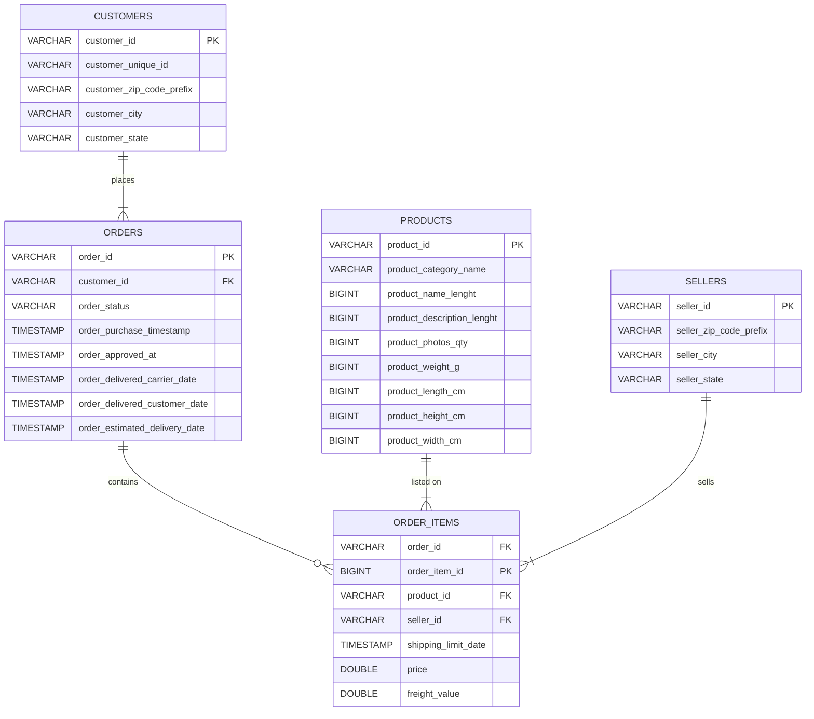
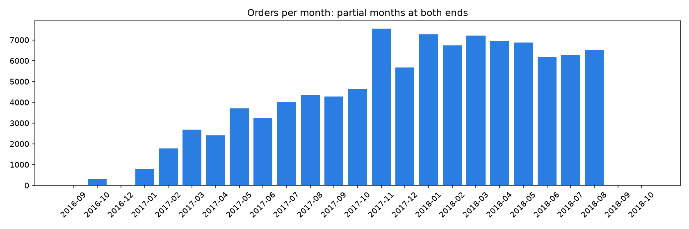

# Assignment 1: Data Quality Analysis and ERD Design

**Objective (from brief):** Explore the Olist dataset in DuckDB, complete the five SQL data-quality exercises in the class notebook, and build a crow’s-foot ERD for five `raw` tables. Prove primary keys, foreign keys, and cardinalities with SQL—not column names alone.

**Data:** Five CSVs in [`Dataset/`](Dataset/) loaded into DuckDB schema `raw`: `customers`, `orders`, `order_items`, `products`, `sellers`.

---

## Submission checklist (PDF deliverables)

| PDF deliverable | Status | File |
|---|---|---|
| ERD (image or PDF) | Ready | [`doc/olist_erd.svg`](doc/olist_erd.svg) |
| Notebook with Exercises 1–5 (SQL on `raw.*` only) | Ready | [`doc/DWH_OLAP_Assignment_1_Notebook.ipynb`](doc/DWH_OLAP_Assignment_1_Notebook.ipynb) |
| Short note (3–5 sentences, Tasks 4a–4c) | Ready | [`doc/short_note.md`](doc/short_note.md) · notebook §7 · [Task 4 below](#task-4--short-note) |

**Before you submit:** Run all cells in the notebook, save the notebook, commit to `kddm_lab`, submit the repo link on e-learning.

**How to run locally:**

```bash
uv sync
uv run jupyter lab
```

Open `doc/DWH_OLAP_Assignment_1_Notebook.ipynb`. DuckDB warehouse: `data/warehouse/ecommerce.duckdb` (created on run, gitignored).

---

## Task 1 — Explore

### 1a. Grain (`DESCRIBE` and `SELECT * … LIMIT 5`)

**PDF question:** What does one row represent?

| Table | Rows | Grain (one row is…) |
|---|---:|---|
| `customers` | 99,441 | one checkout identity for one order |
| `orders` | 99,441 | one customer order |
| `order_items` | 112,650 | one product line inside an order |
| `products` | 32,951 | one catalog product |
| `sellers` | 3,095 | one marketplace seller |

`order_items` has more rows than `orders` because one order can contain several products.

### 1b. Primary keys

**PDF question:** Rows = distinct values, no nulls on the key; one table needs a two-column key.

| Candidate | Rows | Distinct | Nulls | Verdict |
|---|---:|---:|---:|---|
| `customers.customer_id` | 99,441 | 99,441 | 0 | **PK** |
| `customers.customer_unique_id` | 99,441 | 96,096 | 0 | not unique; person-level identifier |
| `orders.order_id` | 99,441 | 99,441 | 0 | **PK** |
| `orders.customer_id` | 99,441 | 99,441 | 0 | unique here, but role is **FK** |
| `order_items.order_id` alone | 112,650 | 98,666 | 0 | not unique |
| `order_items (order_id, order_item_id)` | 112,650 | 112,650 | 0 | **composite PK** |
| `products.product_id` | 32,951 | 32,951 | 0 | **PK** |
| `sellers.seller_id` | 3,095 | 3,095 | 0 | **PK** |

### 1c. Foreign keys (orphan check with `ANTI JOIN`)

**PDF question:** For each relationship, parent, child, linking column; prove with orphans.

| Relationship | Child → parent (column) | Orphan child rows |
|---|---|---:|
| customer places order | `orders.customer_id` → `customers.customer_id` | 0 |
| order contains item | `order_items.order_id` → `orders.order_id` | 0 |
| product on item | `order_items.product_id` → `products.product_id` | 0 |
| seller on item | `order_items.seller_id` → `sellers.seller_id` | 0 |
| order with no items (parent without children) | `orders` left of `order_items` | **775 orders** |

No child row lacks a parent. Some orders have zero items.

---

## Task 2 — Measure cardinality

**PDF question:** Min and max child rows per parent; choose exactly one / zero or one / one or many / zero or many.

| Relationship (verb) | Parent | Child | Min | Max | Parents with 0 children | Diagram choice |
|---|---|---|---:|---:|---:|---|
| places | `customers` | `orders` | 1 | 1 | 0 | ERD: one-or-many; **data: exactly one** |
| contains | `orders` | `order_items` | 0 | 21 | 775 | **zero or many** (circle on order side) |
| listed on | `products` | `order_items` | 1 | 527 | 0 | one or many |
| sells | `sellers` | `order_items` | 1 | 2,033 | 0 | one or many |

Largest fan-out in data: up to **21** items on one order, **527** lines for one product, **2,033** for one seller.

---

## Task 3 — Entity-relationship diagram

**PDF question:** All tables and columns, PK/FK marked, crow’s foot + verb on each line.

Deliverable image:


Composite PK on `order_items` is labeled on both columns in the SVG (`order_id` + `order_item_id`). Mermaid copy in the notebook may tag only one key per column (tool limit).



`order_items` links three other tables (junction / associative table).

---

## Notebook deliverable — Data quality (Exercises 1–5)

The PDF asks you to replace `SELECT 'write your query here'` with one DuckDB query per exercise, reading only `raw.<table>`. Those queries live in [`doc/DWH_OLAP_Assignment_1_Notebook.ipynb`](doc/DWH_OLAP_Assignment_1_Notebook.ipynb) §5. Summary of expected answers:

### Exercise 1 — Orders with no items

**Ask:** Break down orders that have no `order_items` by `order_status`.

| order_status | orders_without_items |
|---|---:|
| unavailable | 603 |
| canceled | 164 |
| created | 5 |
| invoiced | 2 |
| shipped | 1 |

### Exercise 2 — Order status distribution

**Ask:** Count and percentage per `order_status`.

| order_status | n | pct |
|---|---:|---:|
| delivered | 96,478 | 97.02 |
| shipped | 1,107 | 1.11 |
| canceled | 625 | 0.63 |
| unavailable | 609 | 0.61 |
| invoiced | 314 | 0.32 |
| processing | 301 | 0.30 |
| created | 5 | 0.01 |
| approved | 2 | 0.00 |

### Exercise 3 — Timestamps

**Ask:** Nulls and consistency on order dates.

| approved_null | carrier_null | delivered_null | delivered_but_no_date | carrier_after_customer |
|---:|---:|---:|---:|---:|
| 160 | 1,783 | 2,965 | 8 | 23 |

### Exercise 4 — Time coverage

**Ask:** Orders per purchase month (+ bar chart in notebook).



Edge months are partial (2016-09, 2016-12, 2018-09, 2018-10); no 2016-11 in the data.

### Exercise 5 — Product completeness

**Ask:** Category/weight nulls and category count.

| products | category_null | weight_null | weight_zero | n_categories |
|---:|---:|---:|---:|---:|
| 32,951 | 610 | 2 | 4 | 73 |

---

## Task 4 — Short note

**PDF questions:**

- **4a.** Two customer identifier columns—how do they differ; which counts customers?
- **4b.** Junction table and which relationships it resolves.
- **4c.** One relationship stricter than the diagram; one where the circle is justified by data.

**Answer (identical in [`doc/short_note.md`](doc/short_note.md) and notebook §7):**

`customer_id` uniquely identifies one customer row tied to exactly one order in this dataset (99,441 rows, all distinct), so it behaves like a per-checkout identifier. `customer_unique_id` has only 96,096 distinct values, and 2,997 people map to more than one `customer_id`, so you should use `customer_unique_id` when counting distinct customers. The junction table is `order_items`: it connects orders to products and sellers through foreign keys on `order_id`, `product_id`, and `seller_id`, breaking the many-to-many between orders and products into one row per line item. The customers-to-orders relationship is stricter than the one-to-many symbol on the ERD because each customer row has exactly one order (minimum and maximum both 1 in the cardinality check). The optional circle on orders-to-order_items is justified because 775 orders have no matching items in the data.

---

## Supporting numbers (worksheet / diagram)

| Question while working | Answer |
|---|---|
| Distinct people (`customer_unique_id`) | 96,096 |
| People with >1 `customer_id` | 2,997 |
| Unused products or sellers in `order_items` | 0 |
| Orphan FK rows | 0 |

---

## File map

```
kddm_lab/
├── README.md                              ← this document (maps PDF → answers)
├── Dataset/                               ← five Olist CSVs
├── doc/
│   ├── DWH_OLAP_Assignment_1.pdf          ← assignment brief
│   ├── DWH_OLAP_Assignment_1_Notebook.ipynb
│   ├── short_note.md                      ← Task 4 deliverable
│   ├── olist_erd.svg                      ← Task 3 deliverable
│   └── orders_per_month.png
└── data/warehouse/ecommerce.duckdb        ← local only (gitignored)
```
